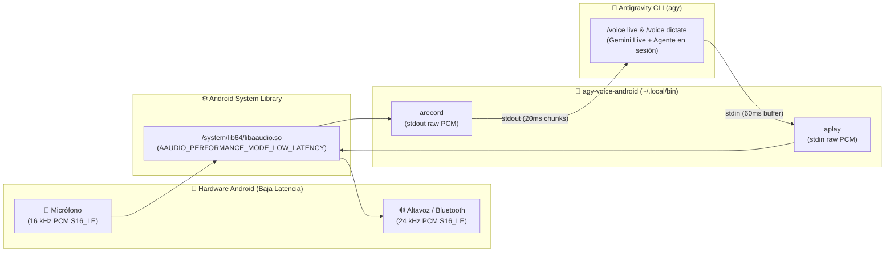

<div align="center">

# 🎙️ agy-voice-android

**Puente nativo de baja latencia en C (`AAudio`) para habilitar `/voice live` y `/voice dictate` de Google Antigravity CLI (`agy`) directamente en Android / Termux — sin PC, sin SSH y sin root.**

[](LICENSE)
[](https://termux.dev/)
[-blue)](#)
[](#arquitectura)
[-4285F4?logo=google&logoColor=white)](#)

[Español](#-el-problema) • [Instalación Rápida](#-instalación-rápida) • [Termux:API APK](#-descargar-la-app-termuxapi) • [Comandos `/voice`](#-comandos-de-voz-en-agy) • [English Summary](#-english-summary)

</div>

---

## 🧩 El Problema

**Google Antigravity CLI (`agy`)** incluye soporte nativo para conversación bidireccional en tiempo real con Gemini Live (`/voice live`) y dictado por voz (`/voice dictate`). Sin embargo, en Linux está diseñado para sistemas de escritorio y busca binarios de **ALSA** (`arecord`, `aplay`), **PipeWire** (`pw-record`, `pw-cat`) o **PulseAudio** (`parec`, `paplay`).

En **Android (Termux sin root)**:
1. El acceso directo al nodo del kernel `/dev/snd/*` está bloqueado por SELinux (`Permission denied`), por lo que las utilidades estándar de ALSA no funcionan.
2. El método alternativo de `agy` (`agy mic-serve` + `ANTIGRAVITY_MIC`) presupone tener una PC externa conectada por túnel SSH.

## ⚡ La Solución

`agy-voice-android` implementa dos binarios ultraligeros en **C puro** (`arecord` y `aplay`) compilados directamente contra la librería nativa de baja latencia de Android **`/system/lib64/libaaudio.so` (Android NDK AAudio API)**:

- **Cero modificaciones a `agy`**: Se instalan en `~/.local/bin` (parte del `PATH` estándar) e implementan exactamente la interfaz de flags que `agy` invoca internamente.
- **Permiso compartido con `Termux:API`**: Aprovecha que `com.termux` y `com.termux.api` comparten el mismo `sharedUserId` de Android. Una vez concedido el permiso `android.permission.RECORD_AUDIO` a **Termux:API**, los binarios nativos en C acceden al micrófono y altavoz por hardware a través de `AAudio` con latencia de milisegundos.
- **Barge-in (Interrupción instantánea)**: Buffer de hardware ajustado a `60 ms` y vaciado inmediato (`AAudioStream_requestFlush`) cuando hablas encima del asistente.
- **Hot-swap de Bluetooth**: Si conectas o desconectas audífonos Bluetooth en medio de una llamada (`AAUDIO_ERROR_DISCONNECTED`), los flujos se reabren automáticamente sin cortar la sesión.

---

## 🏗️ Arquitectura



---

## 📲 Descargar la App Termux:API

Para que Android otorgue el permiso de micrófono (`android.permission.RECORD_AUDIO`) al entorno de Termux, necesitas tener instalada la aplicación complementaria **Termux:API** en tu teléfono:

| Fuente Oficial | Enlace de Descarga |
| :--- | :--- |
| **F-Droid (Recomendado)** | [📦 Descargar Termux:API en F-Droid](https://f-droid.org/packages/com.termux.api/) |
| **GitHub Releases (APK directo)** | [🐙 Descargar APK desde `termux/termux-api` Releases](https://github.com/termux/termux-api/releases) |

> [!IMPORTANT]
> **No mezcles orígenes de instalación:** Si instalaste **Termux** desde F-Droid o GitHub Releases, instala **Termux:API** desde la misma fuente para que ambas APKs tengan la misma firma criptográfica y compartan el UID de Android.

---

## 🚀 Instalación Rápida

### 1. Instalar dependencias en Termux y compilar

Copia y pega este bloque en tu terminal de Termux:

```bash
pkg update -y && pkg install -y clang termux-api git
git clone https://github.com/soyaelithia-ui/agy-voice-android.git ~/herramientas/agy-voice-android
cd ~/herramientas/agy-voice-android
./build.sh
```

### 2. Activar el permiso de micrófono por primera vez

Ejecuta:

```bash
termux-microphone-record -i
```

Aparecerá el cuadro de diálogo nativo de Android pidiendo permiso de micrófono para **Termux:API**. Selecciona **«Mientras la app está en uso»** / **«Permitir»**.
*(Además, `arecord` incluye auto-recuperación: si el permiso no ha sido activado aún, invoca automáticamente `termux-microphone-record -i` y reintenta abrir el stream).*

### 3. ¡Úsalo en `agy`!

Inicia `agy` normalmente y escribe en el chat:

```text
/voice live
```

---

## 🎛️ Comandos de Voz en `agy`

Una vez instalado este puente, todos los comandos nativos de voz de Antigravity CLI funcionan directamente en tu Android:

| Comando / Atajo | Descripción |
| :--- | :--- |
| `/voice live` | Inicia una llamada de voz bidireccional continua con **Gemini Live** |
| `/voice dictate` o `F5` | Dictado por voz: transcribe lo que hablas directamente en la barra de entrada |
| `/voice stop` | Cuelga la llamada en vivo o detiene el dictado |
| `/voice mute` / `/voice unmute` | Silencia o reactiva tu micrófono durante `/voice live` |
| `/voice duplex [on\|off]` | Activa o desactiva la interrupción en vivo (*full-duplex barge-in*) |
| `/voice speaker [nombre]` | Cambia la voz del modelo (ej. `Zephyr`, `Fenrir`, `Charon`, `Puck`, `Kore`, `Aoede`) |
| `/voice volume [0-100]` | Ajusta el volumen de reproducción de la voz |
| `/voice speed [0.5-3]` | Ajusta la velocidad de habla del asistente |

---

## 🔧 Detalles Técnicos y Configuración Avanzada

| Componente | Especificación |
| :--- | :--- |
| **[`arecord.c`](arecord.c)** | Captura `AAUDIO_DIRECTION_INPUT`, `AAUDIO_FORMAT_PCM_I16`, `16000 Hz`, mono, bloques de `20 ms` (`320 frames`). |
| **[`aplay.c`](aplay.c)** | Salida `AAUDIO_DIRECTION_OUTPUT`, `AAUDIO_FORMAT_PCM_I16`, `24000 Hz`, mono, `AAUDIO_USAGE_MEDIA`, `AAUDIO_CONTENT_TYPE_SPEECH`. |
| **Gestión de inactividad (`poll`)** | Cuando el modelo termina de hablar y `stdin` queda sin datos por `> 200 ms`, `aplay` inserta `10 ms` de silencio suave, pausa y vacía el stream (`AAudioStream_requestPause` + `AAudioStream_requestFlush`) para evitar *underruns* y consumo de batería, reactivándolo en `0 ms` apenas llega el siguiente paquete. |
| **Preset del micrófono** | Por defecto usa `AAUDIO_INPUT_PRESET_VOICE_RECOGNITION` para máxima sensibilidad. Si deseas activar la cancelación de eco por DSP de voz en llamada (`AAUDIO_INPUT_PRESET_VOICE_COMMUNICATION`), exporta `AGY_AAUDIO_PRESET=comm`. |
| **Soporte `agy mic-serve`** | También habilita el subcomando `agy mic-serve` en Termux por si deseas servir el micrófono y altavoz de tu teléfono Android hacia otro servidor vía SSH. |

---

## 🌐 English Summary

**`agy-voice-android`** provides native, zero-overhead C shims (`arecord` and `aplay`) backed by Android's NDK **AAudio API** (`/system/lib64/libaaudio.so`) so that Google Antigravity CLI's `/voice live` and `/voice dictate` commands work out-of-the-box on non-rooted Android devices running **Termux**.

1. Install the companion [**Termux:API** APK from F-Droid](https://f-droid.org/packages/com.termux.api/) or [GitHub Releases](https://github.com/termux/termux-api/releases).
2. Run:
   ```bash
   pkg install -y clang termux-api git
   git clone https://github.com/soyaelithia-ui/agy-voice-android.git
   cd agy-voice-android && ./build.sh
   termux-microphone-record -i
   ```
3. Launch `agy` and run `/voice live`.

---

## 📄 Licencia

Distribuido bajo la licencia **MIT**. Consulta el archivo [LICENSE](LICENSE) para más detalles.
